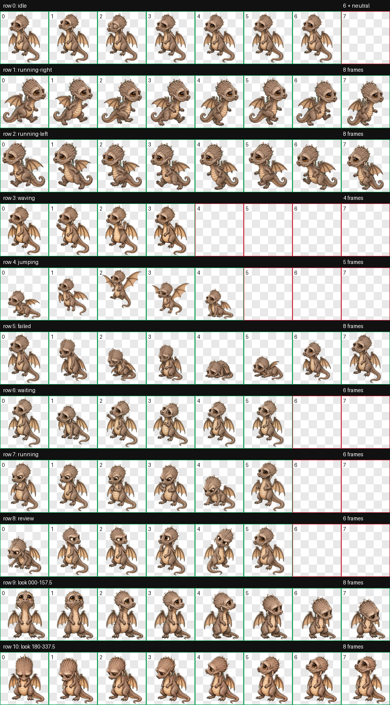

# Scales Codex Pet

[](https://github.com/KanadeK/scales-codex-pet/actions/workflows/ci.yml)
[](https://github.com/KanadeK/scales-codex-pet/releases/latest)
[](ASSET_LICENSE.md)

Scales, the baby dragon from Blender Foundation's open movie *Sintel*, adapted
as a complete Codex companion. The repository ships a native v2 desktop atlas,
a pixel-matched ChatGPT web atlas, a transactional installer, strict format
validation, lifecycle replay, provenance checks, and reproducible release
packaging.

This is an independent fan adaptation. It is not endorsed by Blender
Foundation, OpenAI, or their affiliates.



[中文说明](README.zh-CN.md) ·
[Live pet lab](https://kanadek.github.io/scales-codex-pet/) ·
[Latest release](https://github.com/KanadeK/scales-codex-pet/releases/latest)

## Why this project is different

- **One authoritative atlas:** the `1536x2288` desktop v2 sheet contains all
  nine task states and sixteen look directions.
- **A proven web derivative:** rows 0 through 8 are compiled into the
  `1536x1872` upload format, then compared pixel for pixel.
- **Runtime behavior, not a gallery shell:** the CLI validates, replays,
  installs, diagnoses, rolls back, and packages the actual pet.
- **Recoverable local changes:** reinstall and uninstall move the current pet
  into a timestamped backup instead of deleting it.
- **Offline provenance:** all four upstream references have pinned SHA-256
  values, author records, canonical pages, and CC BY 3.0 attribution.
- **Byte-reproducible archives:** sorted files, fixed ZIP metadata, an internal
  manifest, and release checksums produce identical package bytes across runs.

The selection and public duplicate-search evidence are recorded in
[`docs/RESEARCH.md`](docs/RESEARCH.md). Popularity cannot be guaranteed; the
project instead makes its discoverability thesis and evidence auditable.

## Install

### From a release archive

Download `scales-codex-pet-v0.1.0.zip` and `SHA256SUMS.txt` from the
[latest release](https://github.com/KanadeK/scales-codex-pet/releases/latest),
then verify the archive before extracting it:

```powershell
Get-FileHash .\scales-codex-pet-v0.1.0.zip -Algorithm SHA256
.\scales-codex-pet-v0.1.0\scripts\install.ps1
```

```bash
sha256sum -c SHA256SUMS.txt
./scales-codex-pet-v0.1.0/scripts/install.sh
```

Both scripts install the CLI, strictly validate the pet, and use the
transactional installer. Refresh **Settings > Pets** in Codex after completion.

### From source

Python 3.11 or newer is required.

```bash
python -m pip install -e ".[dev]"
scales-pet validate pet --target desktop --strict
scales-pet install --source pet --dry-run
scales-pet install --source pet
```

To upload Scales on ChatGPT web, use
`web-pet/scales-web-upload.webp` in the custom pet upload flow.

## Real commands

```bash
# Validate either format and emit machine-readable repair details
scales-pet validate pet --target desktop --strict --json
scales-pet validate web-pet/scales-web-upload.webp --target web --strict --json

# Rebuild the web asset and prove it came from desktop rows 0 through 8
scales-pet build-web --source pet --output web-pet/scales-web-upload.webp --json

# Render a task lifecycle from real atlas cells
scales-pet replay examples/scales-quest.json --output build/scales-quest.gif --json

# Compare source and installed copies, including hashes, locks, and backups
scales-pet doctor --source pet --json

# Restore the newest verified backup
scales-pet rollback --json

# Verify all upstream reference bytes without network access
scales-pet verify-provenance artwork/references/sources.json --json
```

Every command returns a nonzero exit code on failure. JSON errors include a
repair action suitable for CI or a support report.

## Acceptance

Run the same gate used before tagging:

```bash
python scripts/release_check.py --json
python -m ruff check .
python -m mypy src
python -m coverage run -m unittest discover -s tests -t . -v
python -m coverage report
python -m build
```

After committing and configuring `origin`, add `--strict` to require a clean
worktree, valid author history, and the expected remote:

```bash
python scripts/release_check.py --strict --json
```

The detailed pass criteria and failure playbook live in
[`docs/ACCEPTANCE.md`](docs/ACCEPTANCE.md) and
[`docs/REPAIR.md`](docs/REPAIR.md).

## Architecture

```text
pet/spritesheet.webp (v2 authority)
        |
        +-- strict cell, alpha, size, residue, and manifest validation
        |
        +-- deterministic crop --> web-pet/scales-web-upload.webp
        |
        +-- scenario renderer --> real-frame GIF evidence
        |
        +-- transactional install --> backup, swap, doctor, rollback
        |
        +-- reproducible package --> manifest + SHA256SUMS
```

See [`docs/ARCHITECTURE.md`](docs/ARCHITECTURE.md) for invariants and trust
boundaries.

## Licenses and attribution

Code, tests, scripts, and original documentation are under the
[MIT License](LICENSE). Scales references and generated visual derivatives are
under [CC BY 3.0](ASSET_LICENSE.md):

> Concept artwork by David Revoy / Blender Foundation; film content
> © copyright Blender Foundation | www.sintel.org.

Exact source pages, bytes, and modification notes are in
[`artwork/references/sources.json`](artwork/references/sources.json).

## Contributing and security

Animation changes must replace a complete semantic row and pass visual QA.
Single-cell cosmetic patches are not accepted because they hide continuity
errors. Start with [`CONTRIBUTING.md`](CONTRIBUTING.md). Report security issues
using [`SECURITY.md`](SECURITY.md), not a public issue.
