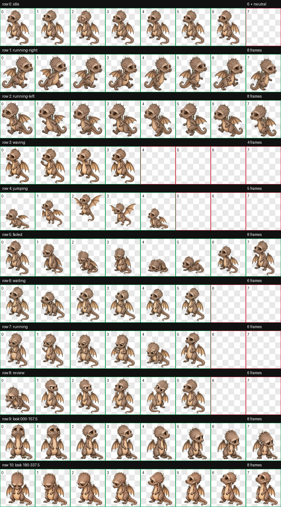

# Scales Codex Pet

这是将 Blender Foundation 开放动画电影 *Sintel* 中的小龙 Scales 制作为
Codex 宠物的完整开源项目。仓库同时提供桌面端 v2 精灵图、与其逐像素一致的
ChatGPT 网页上传版、严格验证器、任务生命周期回放、可回滚安装、来源校验和
可复现发布包。

本项目是独立的同人改编，不受 Blender Foundation、OpenAI 或其关联方背书。



[在线宠物实验台](https://kanadek.github.io/scales-codex-pet/) ·
[最新 Release](https://github.com/KanadeK/scales-codex-pet/releases/latest) ·
[English](README.md)

## 它不是界面空壳

- `pet/spritesheet.webp` 是 `1536x2288` 的权威 v2 图集，包含 9 种任务状态
  和 16 个注视方向。
- `build-web` 会从权威图集裁出网页端的 `1536x1872` 版本，并逐像素验证。
- CLI 会对必需单元格、透明通道、空闲单元格、边缘接触、隐藏 RGB、色键残留、
  文件大小和 `pet.json` 做真实检查。
- 场景回放读取真实图集单元格，不使用演示占位动画。
- 安装采用暂存、校验、备份和原子替换；卸载不会直接删除现有宠物。
- 发布 ZIP 固定顺序、时间戳和权限，包含内部清单及 SHA-256 校验值。

角色选择、历史项目排重和 GitHub 公开搜索快照见
[`docs/RESEARCH.md`](docs/RESEARCH.md)。项目不承诺 Star 数量，只提供可审计
的差异化依据和完整交付质量。

## 安装

需要 Python 3.11 或更高版本。

```powershell
python -m pip install -e ".[dev]"
scales-pet validate pet --target desktop --strict
scales-pet install --source pet --dry-run
scales-pet install --source pet
```

安装完成后，在 Codex 中刷新 **Settings > Pets**。ChatGPT 网页端请上传
`web-pet/scales-web-upload.webp`。

Release 压缩包内也提供：

```powershell
.\scripts\install.ps1
```

```bash
./scripts/install.sh
```

## 验收命令

```bash
python scripts/release_check.py --json
python -m ruff check .
python -m mypy src
python -m coverage run -m unittest discover -s tests -t . -v
python -m coverage report
python -m build
```

提交后再执行严格门禁：

```bash
python scripts/release_check.py --strict --json
```

成功标准和各类失败的修复顺序见
[`docs/ACCEPTANCE.md`](docs/ACCEPTANCE.md) 与
[`docs/REPAIR.md`](docs/REPAIR.md)。

## 常用功能

```bash
# 输出机器可读的错误位置和修复建议
scales-pet validate pet --target desktop --strict --json

# 用真实精灵图渲染一次完整任务状态流
scales-pet replay examples/scales-quest.json --output build/scales-quest.gif --json

# 比较源码与安装版本的哈希，并检查锁和备份
scales-pet doctor --source pet --json

# 恢复最新的已验证备份
scales-pet rollback --json

# 离线核对所有上游参考图字节
scales-pet verify-provenance artwork/references/sources.json --json
```

## 许可证

代码、测试、脚本和原创文档使用 [MIT](LICENSE)。角色参考图与生成的视觉衍生
资产使用 [CC BY 3.0](ASSET_LICENSE.md)：

> Concept artwork by David Revoy / Blender Foundation; film content
> © copyright Blender Foundation | www.sintel.org.

每个参考文件的来源页面、作者、SHA-256 与修改说明都固定记录在
[`artwork/references/sources.json`](artwork/references/sources.json)。
